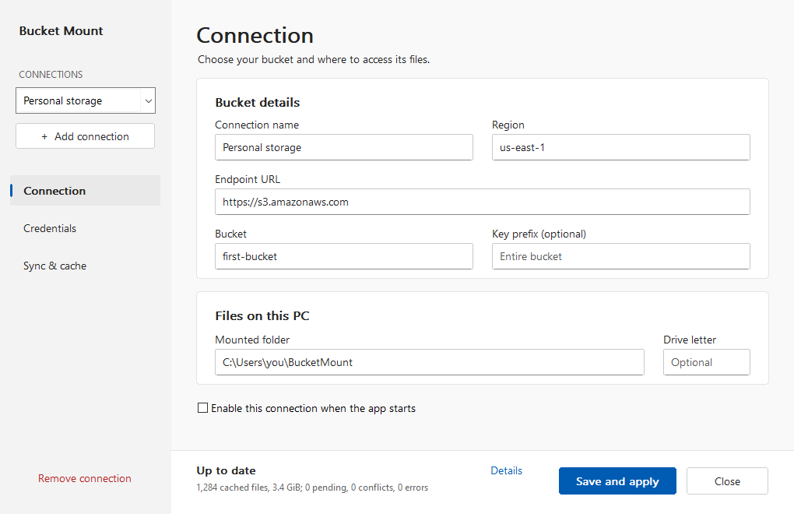
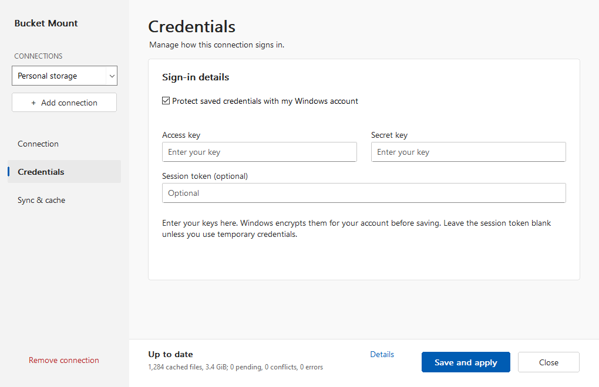
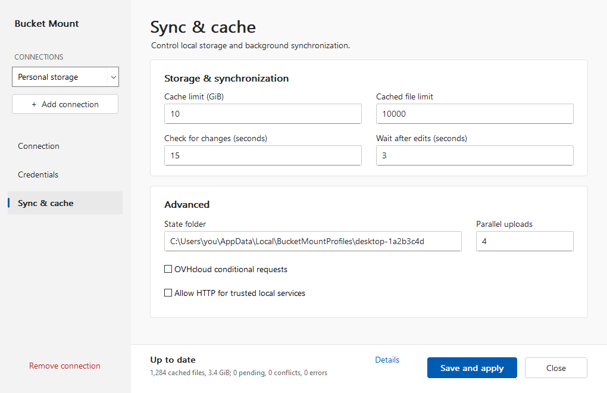
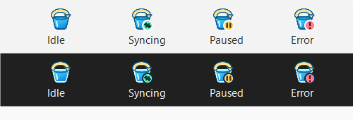

# Bucket Mount

**Your S3 bucket, as ordinary files in Windows File Explorer.**



Bucket Mount connects an S3-compatible bucket to a folder on your PC using the Windows Cloud
Files platform — the same foundation behind OneDrive *Files On-Demand*. You see every object in
Explorer straight away, files download when you open them, and your edits upload in the
background.

## Why you might want it

- **No full download.** Thousands of objects appear in Explorer as small *online-only*
  placeholders; only the files you open take up disk space.
- **Your normal apps.** Word, Excel, Visual Studio Code, or a build script open and save files in
  the bucket as if they were local.
- **Offline copies when you need them.** Files you have opened stay available offline, and you can
  pin a file or folder in Explorer to keep it. Bucket Mount trims the local cache automatically
  once it grows past the limit you set.
- **Background synchronization.** Local changes upload within seconds, and changes made from
  anywhere else (another PC, a server, the AWS console) arrive in your folder.
- **Several buckets at once.** Add one connection per bucket, account, prefix, or team — each with
  its own folder, cache, and credentials.
- **It stays out of the way.** Everything runs from a tray icon: no browser, no service, no
  administrator rights.

## What you need

- **Windows 10 version 1709 or later, or Windows 11**, 64-bit.
- An **empty local NTFS folder** for each connection, on a fixed or removable drive. Cloud Files,
  the USN journal, and offline pins all require NTFS. Folder redirection, junctions, and OneDrive
  folders are not supported as the mount point.
- An **S3-compatible bucket** with its endpoint URL and region, such as AWS S3, Cloudflare R2,
  Backblaze B2, MinIO, Ceph, RustFS, or OVHcloud Object Storage.
- **Access credentials** that may list the bucket and read, write, delete, and multipart-upload
  objects under the prefix you choose.

Bucket Mount tests the connection before it starts, including the conditional (compare-and-swap)
requests that protect your files from being overwritten by another device. If the service cannot
honour them, synchronization is refused rather than risking data loss.

## Install

### Installer (recommended)

1. Download `bucket-mount-1.0.0-windows-x64-setup.exe` for Intel/AMD PCs, or
   `bucket-mount-1.0.0-windows-arm64-setup.exe` for Windows on ARM, from a release.
2. Double-click it and follow the prompts. Administrator rights are not required.
3. Choose whether Bucket Mount should start when you sign in.

Setup installs into `%LOCALAPPDATA%\BucketMount\bin`, adds a **Bucket Mount** entry to the Start
menu, and offers to start the app when it finishes. To remove the installation later, use
**Settings → Apps** or run `uninstall.exe` from that folder.

### Portable ZIP

1. Download `bucket-mount-1.0.0-windows-x64-portable.zip` or
   `bucket-mount-1.0.0-windows-arm64-portable.zip` for your PC and extract it anywhere.
2. Double-click `bucket-mount.exe`.

The portable build needs no installer and no administrator rights, but it does not add a Start
menu shortcut and does not start with Windows. Its settings, logs, and sync state still live in
`%LOCALAPPDATA%\BucketMount`, so an installed copy and a portable copy on the same Windows account
share one configuration; both cannot run at the same time. Copying the folder to another PC does
not carry over your settings, and protected credentials normally need to be entered again there.

Release packages ship with a `.sha256` checksum file.

## Set up your first connection

The **Connections** window opens the first time you start Bucket Mount. You can reopen it at any
time from the tray menu.

1. **Name the connection.** It is only a label for the tray menu and this window.
2. **Enter the bucket.** Fill in **Endpoint URL** (`https://s3.us-east-1.amazonaws.com`,
   `https://s3.eu-west-par.io.cloud.ovh.net`, `http://192.168.1.20:9000`, …), **Bucket**, and
   **Region**. Use **Key prefix** to expose only part of a bucket, for example `projects/2026/`.
3. **Choose where the files appear.** **Mounted folder** must be an empty NTFS folder. Optionally
   set a **Drive letter** to reach the same files as `S:\`.
4. **Add credentials** on the **Credentials** page and keep **Protect saved credentials with my
   Windows account** selected.

   

5. **Click Save and apply.** The connection starts immediately.

**Credentials in environment variables** instead of the app: clear the protection checkbox and
enter variable *names* such as `AWS_ACCESS_KEY_ID`, `AWS_SECRET_ACCESS_KEY`, and optionally
`AWS_SESSION_TOKEN`. Set them as Windows user variables and sign out and back in so new processes
inherit them. Different connections may use different variable names; a blank session token
variable means "no token".

> **Start with an empty folder.** Files already in the mounted folder are treated as local changes
> and uploaded to the bucket. A state folder belongs to exactly one bucket, endpoint, prefix, and
> mounted folder; to change any of these, add a new connection with fresh folders.

### Sync & cache settings



| Setting | Default | What it does |
| --- | --- | --- |
| Cache limit | 10 GiB | Downloads are removed from disk (files become online-only again) once cached data exceeds this size. |
| Cached file limit | 10 000 | Same, counted in files instead of bytes. |
| Check for changes | 15 s | How often the bucket listing is fetched. Lower values react faster to remote edits, at the cost of more requests. |
| Wait after edits | 3 s | Grace period before an edit is uploaded or a deletion is sent to the bucket, so half-finished saves and renames do not cause extra requests. |
| Parallel uploads | 4 | Concurrent uploads *and* concurrent on-demand downloads. |
| State folder | per connection | Where the sync database, staging area, and lock live. Keep it off the mounted folder. |
| OVHcloud conditional requests | off | Sends bare ETags, as OVHcloud's conditional request API requires. Leave off for AWS S3, MinIO, RustFS, and most other services. |
| Allow HTTP for trusted local services | off | Permits a plain `http://` endpoint such as a MinIO or RustFS server on your LAN. Never enable it for the internet. |
| Enable this connection when the app starts | on | Uncheck to stop a connection and keep it stopped after a restart. |

Every enabled connection synchronizes at the same time.

## Everyday use

### The tray icon

The icon shows the combined state of all connections, in a light or dark variant to match the
taskbar:



Hovering over the icon shows a summary; **Details** in the Connections window shows the full status
or connection error.

### The tray menu

| Menu item | What it does |
| --- | --- |
| **Connections…** | Opens the Connections window (also a double-click on the icon). |
| **Connection name → Open mounted folder** | Opens that connection's files in Explorer. |
| **Connection name → Sync now** | Requests an immediate synchronization pass. |
| **Connection name → Pause / Resume synchronization** | Stops or resumes background work for that connection. |
| **Sync all connections now** | Requests a pass for every enabled connection. |
| **Pause / Resume all connections** | Controls background synchronization for all connections. |
| **Quit Bucket Mount** | Finishes the current passes and exits. Online-only files need the app running again. |

**Opening a file** downloads it. Downloaded files stay available offline until the cache needs the
space; after that they become online-only again and need a connection. Pausing takes effect after
the current pass — opening an online-only file still downloads it while paused.

### Editing and deleting

- **Changes and deletions synchronize with the bucket.** Editing a file uploads a new revision;
  deleting a file or folder removes the matching objects.
- **Renaming** uploads the file under its new key and then removes the old object.
- **Simultaneous edits never overwrite each other.** If a file changed in the bucket while you were
  editing it, Bucket Mount keeps your version as a separate copy next to the original —
  `report.conflict-desktop-1a2b3c4d9e8f.docx` — and refreshes the original to the bucket's revision.
  Both copies synchronize, so you can compare them and delete the one you do not need. Edits are
  never merged.
- **Deletions are deliberate.** A remote object is only removed after the local file has been gone
  for the grace period, and every write uses a conditional request, so a stale device cannot
  delete a newer revision.

## Credentials and security

- Saved keys are encrypted with **Windows DPAPI** for your Windows account and this PC before being
  written to the settings file. They are never shown again in the editor: leave the fields blank to
  keep them, or enter both keys to replace them (a blank session token removes the old token).
- Anything running as your Windows account can ask Windows to decrypt them, so treat the Windows
  account as the security boundary.
- Credentials are only ever sent to the endpoint you configure, over TLS. `http://` endpoints are
  refused unless you explicitly allow them for a local test server.
- Every connection verifies conditional request support by writing and deleting a uniquely named
  probe object under `<prefix>.bucket-mount/probes/`. The bucket policy must allow that; no other
  internal objects are created.
- **Never put secrets in `config.toml` by hand.** The settings file only stores DPAPI ciphertext or
  environment variable names.

## Command line

`bucket-mount.exe` is also usable without the UI, which is handy for servers and scheduled tasks:

```text
bucket-mount [--config <PATH>] [run|init|check|sync-once]
```

| Command | Description |
| --- | --- |
| `run` | Start the tray application (the default when no command is given). |
| `init` | Write a settings template and never overwrite an existing file. |
| `check` | Validate settings and credentials, list the bucket, and verify conditional request support. |
| `sync-once` | Run two synchronization passes, then exit non-zero if any file failed. |
| `--config <PATH>` | Use a different settings file; logs belong beside it in `logs\`. |

`check` and `sync-once` process the enabled connections of the settings file and print one line per
connection.

## Settings file

The app writes all connections to one TOML file:

- **Settings:** `%LOCALAPPDATA%\BucketMount\config.toml`
- **Per-connection sync state:** `%LOCALAPPDATA%\BucketMountProfiles\<device id>\`
- **Logs:** `%LOCALAPPDATA%\BucketMount\logs\bucket-mount.log.<date>`

The **Connections** window is the normal way to change settings; the file is validated on load and
connection names, device identities, folders, and drive letters must stay unique. For scripted or
server use, `bucket-mount.exe init` writes a complete template in this format that you can copy and
fill in.

| Key | Meaning |
| --- | --- |
| `format_version` | Settings format; must be `1`. |
| `[[connections]] name`, `enabled` | Label shown in the UI and whether the connection runs at startup. |
| `endpoint`, `bucket`, `region`, `prefix` | Where the objects live. The prefix is normalized to end with `/`. |
| `mount_dir`, `state_dir` | Absolute, separate folders; the mounted folder holds your files, the state folder the database. |
| `drive_letter` | Optional single letter, A–Z. |
| `cache_max_bytes`, `cache_max_files` | Local cache limits. |
| `poll_interval_secs`, `settle_delay_secs`, `upload_concurrency` | Timing and parallelism (see the table above). |
| `allow_http` | Permit a plain-HTTP endpoint. |
| `conditional_etag_format` | `quoted` (default) or `bare` (OVHcloud). |
| `device_id` | Unique per connection; identifies this device in conflict names and placeholder metadata. Never copy it to another PC. |
| `access_key_env`, `secret_key_env`, `session_token_env` | Environment variable names, used when no protected credentials are saved. |
| `protected_credentials` | DPAPI ciphertext written by the app. Do not edit. |

Set `RUST_LOG` (for example `RUST_LOG=bucket_mount=debug`) to make the log more verbose.

## Limits and unsupported names

Bucket Mount follows the Windows file system where it must, and refuses anything it cannot
represent faithfully:

- Object keys must be **valid Unicode** and legal Windows file names: no `\ / : * ? " < > |`, no
  trailing dots or spaces, no reserved device names (`CON`, `NUL`, `COM1`, …), and no component
  longer than 255 characters. Total keys may be up to 1024 bytes; deep paths are supported.
- **Case and file/directory collisions are rejected**, because Windows cannot distinguish `File.txt`
  from `file.txt`, or a file named `a` from a folder named `a`. One such object stops that
  connection's pass with a message naming the collision; rename the object in the bucket to
  continue.
- **Symbolic links and junctions** are not followed or synchronized.
- Objects larger than 5 TiB, and bucket policies that deny conditional requests, are unsupported.

## Having trouble?

| Symptom | What to try |
| --- | --- |
| **Cannot connect** | Select the connection to read the full error. Check endpoint, bucket, region, credentials, and bucket permissions, then **Save and apply**. `check` prints the same details on the console. |
| **`AccessDenied` on save or during the probe** | The credentials need list, read, write, delete, and multipart-upload rights, including on `<prefix>.bucket-mount/probes/`. |
| **OVHcloud connection fails** | Enable **OVHcloud conditional requests**. `InvalidAccessKeyId` means the key does not belong to that Object Storage project and endpoint — re-enter both keys. |
| **`Sync deferred: Windows namespace collision`** | Two bucket objects map to the same Windows path. Rename one of them in the bucket. |
| **Saved credentials cannot be unlocked** | Windows could not decrypt them (another account, another PC, or a reset profile). Enter both keys again. |
| **Settings did not take effect** | Click **Save and apply** and let the current synchronization finish; a running connection completes its pass before restarting with the new settings. |
| **A file will not open offline** | It may not have been downloaded yet, or its cached copy was evicted. Reconnect and open it with Bucket Mount running. |
| **Cache never shrinks** | Pinned files (Explorer → **Always keep on this device**) and files that are open in another program are kept; the status bar reports "cache pinned or busy". |
| **Already managing this configuration** | Another Bucket Mount process is running for the same settings file. Quit it from the tray menu. |

Logs in `%LOCALAPPDATA%\BucketMount\logs` (or `logs` beside a custom settings file) include the
connection's device ID and the reason for each deferred file.

## Uninstall

Open **Windows Settings → Apps**, select **Bucket Mount**, and choose **Uninstall** — or run
`uninstall.exe` from `%LOCALAPPDATA%\BucketMount\bin`. Settings, sync folders, and bucket contents
are preserved, so reinstalling restores access to online-only files. To remove the portable build,
quit the app and delete the extracted files.

## For developers

```powershell
# Install both target standard libraries into the pinned host toolchain
rustup target add x86_64-pc-windows-msvc aarch64-pc-windows-msvc

# Checks, tests, and packages both Windows architectures into dist\
.\scripts\build.ps1

# Build just one architecture
.\scripts\build.ps1 -Architecture arm64

# Quick loops
cargo fmt --all -- --check
cargo clippy --all-targets -- -D warnings
cargo test --all-targets
.\scripts\test-build.ps1  # packaging, target isolation, and checksum regression tests
```

The build needs the pinned toolchain from [rust-toolchain.toml](rust-toolchain.toml), the Visual
Studio C++ build tools for x64 **and ARM64**, and a Windows SDK (`rc.exe`). In Visual Studio
Installer, include the MSVC ARM64 build tools and **C++ Clang Compiler for Windows** in addition
to Desktop development with C++. The ARM64 crypto dependency requires `clang-cl`; a standalone
LLVM installation on PATH also works.
The script selects the native Rust host toolchain and cross-compiles when needed. Cross builds
compile the target's tests without executing them; CI runs all regular tests on native x64 and
ARM64 runners. Output directories and embedded setup payloads are isolated by target, and PE
headers are checked before packaging. `-GnuToolchainBin` retains the optional x64 LLVM MinGW
build; ARM64 uses MSVC. `-Offline` avoids downloads.

Tests that need real Windows infrastructure are `#[ignore]`d so hosted CI stays portable:

```powershell
cargo test --lib -- --ignored --test-threads=1   # Cloud Files, tray UI, two-device sync
.\scripts\test-rustfs.ps1                        # live S3 tests against local RustFS
```

The UI preview test writes BMP captures of every page at several sizes and DPI settings; convert
them to PNG for the documentation images:

```powershell
$env:BUCKET_MOUNT_UI_PREVIEW_DIR = "$env:TEMP\bucket-mount-previews"
cargo test --lib native_editor_manages_profiles_and_encrypts_credentials -- --ignored
```

Pushing a tag (`v1.0.0`) runs the [Windows workflow](.github/workflows/windows.yml), which checks
formatting, Clippy, and tests on both architectures, then publishes both setup executables and
portable ZIPs with SHA256 checksums on a GitHub release. Both build jobs must succeed before
publication.

## License

Licensed under the [MIT license](LICENSE).
